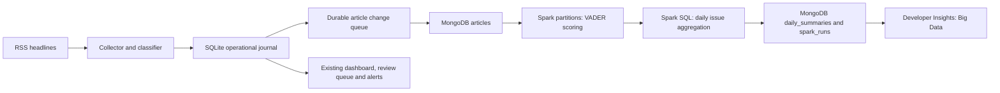

# MongoDB + Apache Spark

## Data flow

This profile adds a real Spark batch workload while retaining the existing collector
and interactive views. The classifier still runs through Ollama/keyword fallback in
the collector. Spark distributes **sentiment scoring and aggregation**, not LLM calls.
The project stores headlines and article metadata; it does not download article bodies.

## Runtime and configuration

Use the startup commands in the [README](../README.md#mongodb--apache-spark).
The additional packages are `pymongo>=4.10,<5` and `pyspark==3.5.7`, with
`org.mongodb.spark:mongo-spark-connector_2.12:10.7.0`. This pairing follows the
[MongoDB connector compatibility table](https://www.mongodb.com/docs/spark-connector/v10.x/).
Use Java 17 as supported by [Spark 3.5.7](https://spark.apache.org/docs/3.5.7/).

`big_data` in `config/settings.yaml` controls the profile. Environment values override
the corresponding fields. `enabled` turns on end-of-collection Mongo sync and dashboard
access; the explicit `run_big_data.py` command works independently of that flag.
Mongo connection strings are stored as `SecretStr` and are never displayed by the app.
The provided Compose service binds port 27017 to loopback for local development.

The default Spark master is `local[*]` with four processing/shuffle partitions. Increase
`VOTERPULSE_SPARK_PARTITIONS` for a larger corpus and inspect the Spark execution plan
and UI to see tasks/shuffles. An empty or small Mongo collection can have fewer input
partitions; the job repartitions the workload for parallel scoring.

## Article storage and retries

MongoDB `articles` contains one document per normalized headline hash (`_id`). Fields
include headline, source, link, feed, publication/ingestion dates, primary/secondary issue,
classification provenance, regional relevance, and the existing score/audit fields.
Timestamps are BSON UTC dates. `event_time` uses publication time unless missing or
later than ingestion, matching the existing dashboard's rule.

SQLite migration 3 queues existing articles and installs triggers for article,
classification, and sentiment changes. Synchronization reads at most `sync_batch_size`
items at a time and performs idempotent Mongo replacements/deletes. Full replacements
clear stale classifications after requeueing. A deletion queue preserves hashes even
if SQLite reuses an article ID. Acknowledgments remove only the transmitted revisions.
Each bounded batch holds the SQLite writer lock during the Mongo write, preventing
concurrent synchronizers from publishing stale changes; Mongo timeouts bound network waits.

Live and demo use separate Mongo databases and matching dataset stamps. A source journal
identity prevents accidentally merging a newly created SQLite journal into a previous
corpus. Preserve the SQLite journal when restoring it, or configure a fresh Mongo
database. `--full-sync` requeues every current article for an empty/new Mongo destination.
It does not prune extra documents from an old backup whose deletion tombstones were
already acknowledged. Use a fresh destination for a complete rebuild from the journal.
Demo regeneration deletes rows through the journal so Mongo receives their tombstones.

`run_pipeline.py --recheck-region` queues changes for the next synchronization;
run `run_big_data.py` afterward to refresh Mongo and the batch summaries immediately.

## Spark computation and publication

Spark reads `articles` using an explicit schema and the connector's partitioned reader.
The entire corpus is never collected into a Python list or pandas DataFrame on the
driver. Spark filters by dataset kind, synthetic/live status, primary issue, relevance,
and regional status. Accepted headlines are rescored with VADER on Python workers using
the configured inclusive positive/negative thresholds. Unclassified/rejected articles
remain in Mongo for auditing but are excluded from summaries.

Spark SQL groups by **IST calendar day and primary issue**, producing article count,
positive/neutral/negative counts, mean compound score, and distinct source count.
The connector writes the summaries back to Mongo. Each job uses a unique run ID, so
partial writes cannot overwrite earlier results. The `spark_runs` status becomes
`success` only after result writes succeed. Developer Insights reads only the newest
successful run and bounded daily summary rows (90 days, at most 1,000 displayed).
Empty successful batches are represented honestly as empty results.

Batch timestamps describe when analytics were computed, not when RSS was last collected.
Live Mongo reads are not a transactional snapshot across a concurrently running sync;
pause collection/sync while running a reproducible benchmark. Failed/old batch documents
are retained for inspection; long-running deployments need a retention policy.

## Running on a cluster

Set `VOTERPULSE_SPARK_MASTER` to a configured Spark master, for example
`spark://spark-master:7077`, and use a Mongo URI reachable from **all executors**.
Every worker needs the matching Python version and `vaderSentiment==3.3.2`; install
the project dependencies in the same worker environment. The job distributes its
Python project modules, but third-party dependencies must be installed on workers.
Configure Spark networking, authentication, and executor resources for your cluster.
Keep Spark/Scala/connector versions aligned. The included Compose file provisions
MongoDB only; it is not a Spark cluster deployment.

Local execution proves that partitions/tasks run in Spark, not that the application has
been benchmarked at big-data scale. Collection and LLM classification remain sequential
and capped per run; assess their throughput separately from the Spark batch.

## Validation

Run `pytest` for outbox/migration/retry/isolation checks, UI states, pipeline failure
reporting, and Spark aggregation parity. Numerical Spark tests require Java and PySpark;
they use local partitions without a Mongo server. For an end-to-end service check,
start MongoDB and run the demo commands in the README, then inspect the Big Data tab.

Verified on macOS ARM64 with Python 3.13.9, Java 17, MongoDB 8.0.16, Spark 3.5.7,
and connector 10.7.0: **204 tests passed**. An isolated end-to-end run synchronized
12,000 synthetic documents, processed 7,200 eligible headlines across four partitions
on two local cores, and read the saved summaries through the dashboard data layer.
Repeated synchronization performed zero writes; deleting the corpus and rerunning
published an empty successful batch without displaying stale summaries. This check
also exercised a URI database path and an unacknowledged-write URI override to verify
that configured dataset isolation and acknowledged publication are enforced.
